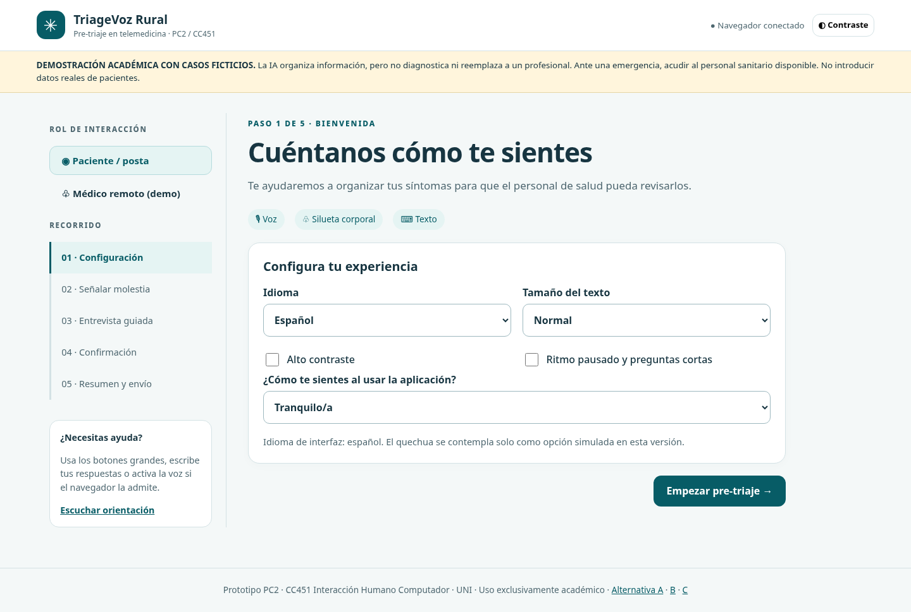
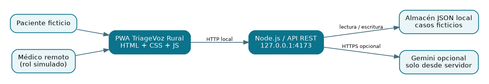
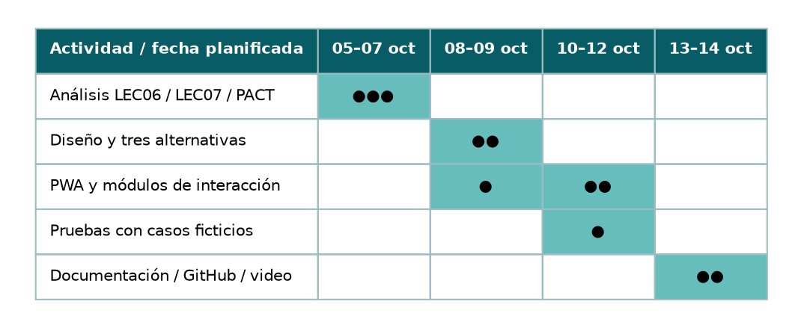

# CC451 — PC2: entrega académica y evidencias

> **Integrantes, Grupo 10 — CC451 PC2:** Santa Cruz Basilio, Jesus Diego — 20235005G | López Arteaga, César Omar — 20236743A | Pumayauli Evangelista, Bryan José — 20212209E.

**Proyecto:** TriageVoz Rural — interfaz no convencional de apoyo al pre-triaje rural.  
**Autor de este aporte:** César Omar López Arteaga.  
**Base de diseño:** LEC06 (stakeholders, RF-01…RF-17, RNF-01…RNF-10, HU-01…HU-10) y LEC07 (CU-07-01-M y SCAMPER).  
**Estado:** prototipo académico; simulación con datos ficticios. La interfaz **no proporciona diagnóstico médico** ni está validada clínicamente.

## 1. Informes y documentos descargables

| Documento | Archivo |
|---|---|
| **Informe PC2 editable** | [Descargar Word DOCX](01-informe-PC2.docx) |
| **Informe PC2 para presentar** | [Abrir PDF](01-informe-PC2.pdf) |
| Aporte individual editable | [Descargar aporte DOCX](../mi-aporte-cesar-lopez-arteaga.docx) |
| Aporte individual en formato solicitado | [Descargar aporte DOC](../mi-aporte-cesar-lopez-arteaga.doc) |
| Enunciado PC2 | [Abrir enunciado PDF](PC02-enunciado.pdf) |
| Lección base LEC06 | [Abrir LEC06 PDF](LEC06-fuente.pdf) |
| Lección base LEC07 | [Abrir LEC07 PDF](LEC07-fuente.pdf) |

También están disponibles las versiones Markdown del informe (`01-informe-PC2.md`), arquitectura (`02-arquitectura-C4.md`), flujo (`03-flujo-pantallas.md`), cronograma (`04-gantt.md`), trazabilidad (`05-trazabilidad.csv`) e historias de usuario (`11-historias-usuario.md`).

## 2. Capturas de la aplicación en funcionamiento

Las siguientes imágenes son evidencias de la **simulación local** con datos ficticios. No constituyen pruebas clínicas.

| Etapa de demostración | Captura |
|---|---|
| Inicio y opciones en escritorio | [01 — Inicio escritorio](../assets/01-inicio-desktop.png) |
| Confirmación de datos | [02 — Confirmación](../assets/02-confirmacion.png) |
| Resumen de pre-triaje | [03 — Resumen](../assets/03-resumen.png) |
| Caso enviado | [04 — Enviado](../assets/04-enviado.png) |
| Revisión por médico remoto (simulada) | [05 — Médico](../assets/05-vista-medico.png) |
| Estado de recepción | [06 — Recibido](../assets/06-recibido.png) |
| Inicio en teléfono móvil | [08 — Móvil](../assets/08-inicio-movil.png) |

### Comparación de tres alternativas de diseño

| Alternativa | Captura | Fuente navegable |
|---|---|---|
| A — Formulario | [Ver prototipo A](../assets/07-prototipo-A.png) | [Abrir HTML A](../public/prototipos/alternativa-a.html) |
| B — Voz | [Ver prototipo B](../assets/07-prototipo-B.png) | [Abrir HTML B](../public/prototipos/alternativa-b.html) |
| C — Multimodal integrado | [Ver prototipo C](../assets/07-prototipo-C.png) | [Abrir HTML C](../public/prototipos/alternativa-c.html) |

## 3. Arquitectura, interacciones y Gantt

- [Diagrama de arquitectura C4 (PNG)](../assets/c4.png) · [fuente DOT](../assets/c4.dot).
- [Diagrama de flujo de pantallas (PNG)](../assets/flujo.png) · [fuente DOT](../assets/flujo.dot).
- [Diagrama de Gantt (PNG)](../assets/gantt.png) · [fuente DOT](../assets/gantt.dot).

## 4. Ejecución y pruebas

Instalación de demostración: ejecutar `npm start` con Node.js 20+ y visitar `http://127.0.0.1:4173`. Las pruebas automatizadas están disponibles con `npm test`. Consultar [documentación de pruebas](06-pruebas-y-evidencias.md) y [guía de instalación](09-guia-instalacion-y-github.md).

## 5. Correspondencia con la rúbrica

- **Reporte (13 pts):** informes PC2 DOCX/PDF y matrices/documentos `docs/`.
- **Diseño óptimo (3 pts):** imágenes de tres alternativas, simulación de flujo y prototipos HTML.
- **Sustentación (4 pts):** [guía de sustentación](07-guia-sustentacion.md) y [aporte individual](../mi-aporte-cesar-lopez-arteaga.docx). **El video de sustentación debe ser grabado y adjuntado por el grupo**; no se presenta como completado.
- **Repositorio:** README, LICENSE MIT, diagrama C4, guía de instalación, PWA y datos ficticios.

**Límites:** la voz depende del navegador; el modelo de IA remoto es opcional y requiere una clave configurada en el servidor. La gestión de roles es simulada, no apta para tratar datos de pacientes reales.