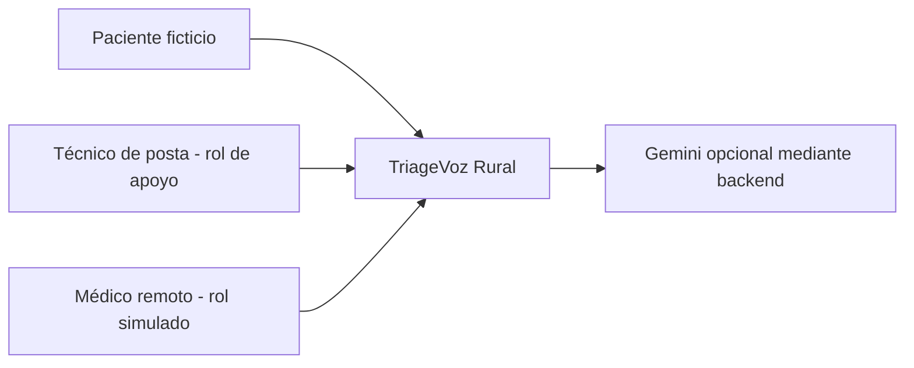
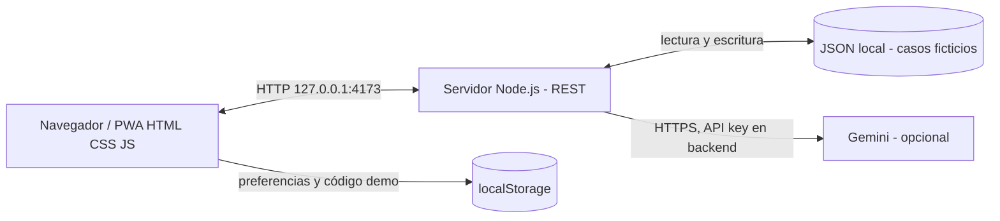
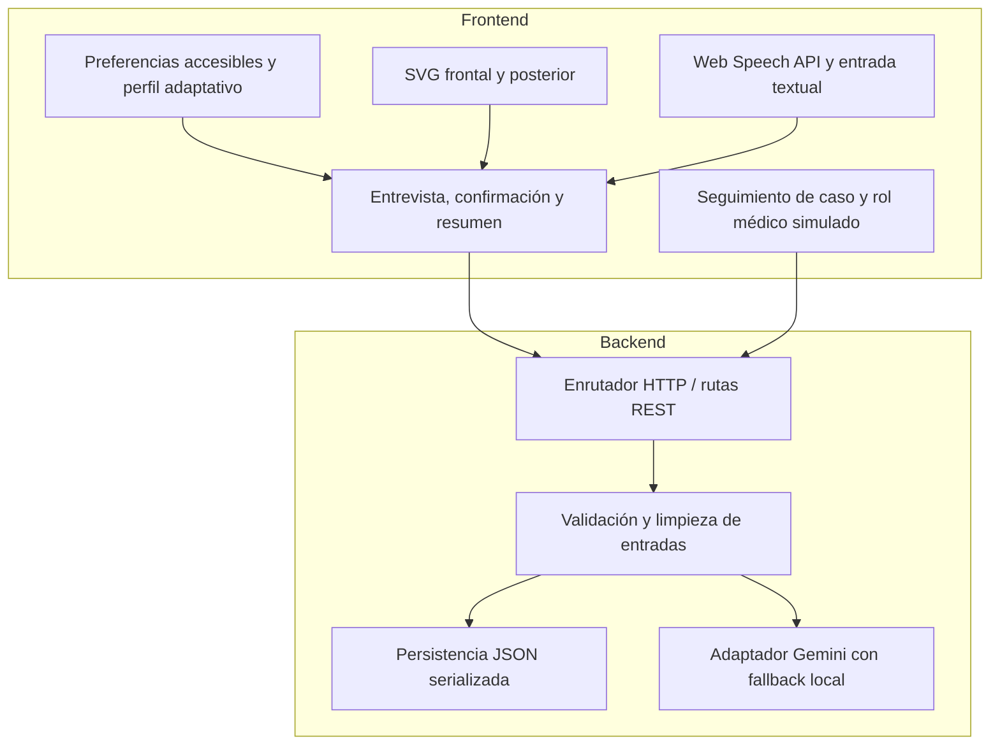

# Arquitectura C4 — TriageVoz Rural, versión PC2 revisada

> **Integrantes, Grupo 10:** Santa Cruz Basilio, Jesus Diego (20235005G); López Arteaga, César Omar (20215508C); Pumayauli Evangelista, Bryan José (20212209E).

## C1 — Contexto del sistema

La aplicación demuestra un **intercambio diferido de casos** entre dos vistas mediante un mismo servidor **local**. No implementa sesión audiovisual, chat en tiempo real, autenticación sanitaria ni telemedicina en producción.

## C2 — Contenedores

La ruta `GET /api/rooms` proporciona los **últimos 12 casos simulados**, enviados y recibidos; no constituye una lista de usuarios conectados. `GET /api/cases/by-code` consulta un caso; `POST /api/cases` lo registra; `POST /api/cases/ack` confirma recepción y `POST /api/cases/reply` añade una respuesta ficticia. `POST /api/llm` resume el relato mediante Gemini, o con un resumen determinista local.

## C3 — Componentes

## Decisiones verificables y restricciones

- Node.js escucha en `127.0.0.1` por defecto. Un segundo usuario en otra computadora **no puede conectarse** a ese localhost sin una infraestructura adicional.
- Los reintentos idénticos de una respuesta no duplican el último registro; un acuse repetido no modifica la marca temporal original. La persistencia se serializa para evitar conflictos entre escrituras.
- Las pruebas automáticas se ejecutan con archivos temporales y no deben modificar `data/runtime.json` del usuario.
- Los estados `enviado` y `recibido` corresponden a la **simulación**, no a la recepción por un profesional clínico real.
- No hay RBAC ni cifrado sanitario de historiales. **Prohibido utilizar datos reales de pacientes.**
