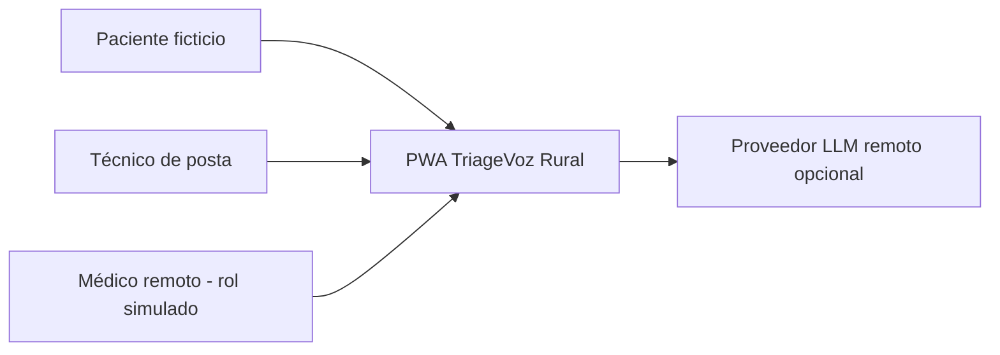
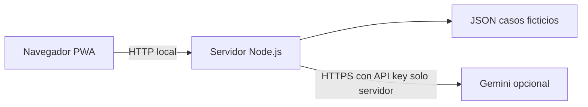

# Arquitectura C4 — TriageVoz Rural (prototipo)

## C1: Contexto

## C2: Contenedores

## C3: Componentes

Frontend: preferencias, Web Speech API, silueta corporal, entrevista, confirmación, seguimiento. Backend: rutas REST, validador/sanitizador, adaptador LLM con fallback determinista y persistencia local.

La aplicación es demostrativa: la API de casos no tiene RBAC clínico, cifrado de registros ni consentimiento sanitario real.
