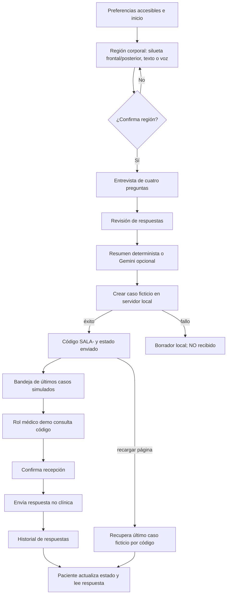

# Navegación e interacciones — versión revisada

> **Integrantes, Grupo 10:** Santa Cruz Basilio, Jesus Diego (20235005G); López Arteaga, César Omar (20236743A); Pumayauli Evangelista, Bryan José (20212209E).

**Nota:** El prefijo `SALA-` es una etiqueta visual para consultar casos; no indica una sesión de videollamada, canal en tiempo real o autenticación de participantes. La bandeja permite consultar registros locales enviados y recibidos.
