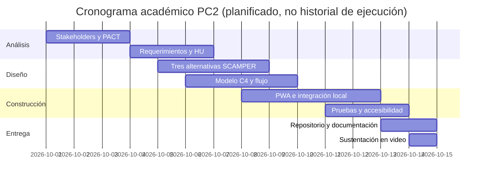

# Gantt propuesto del proyecto

> **Integrantes, Grupo 10 — CC451 PC2:** Santa Cruz Basilio, Jesus Diego — 20235005G | López Arteaga, César Omar — 20215508C | Pumayauli Evangelista, Bryan José — 20212209E.

