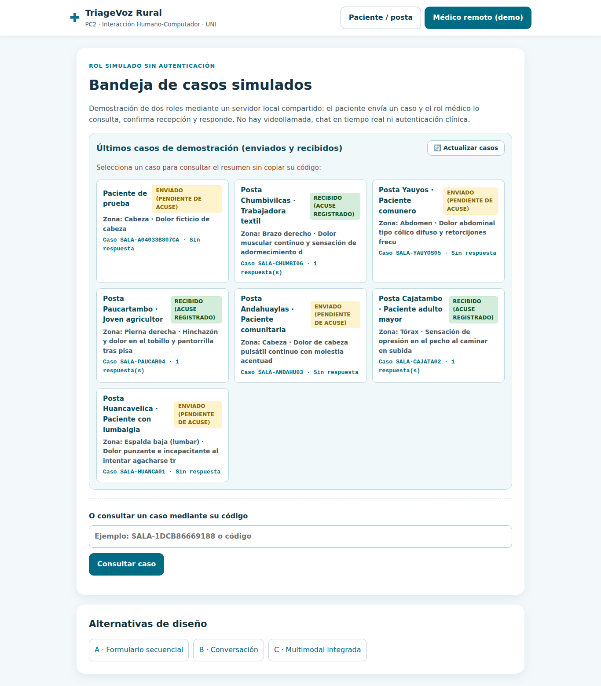
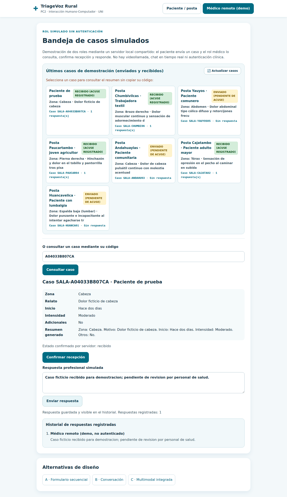
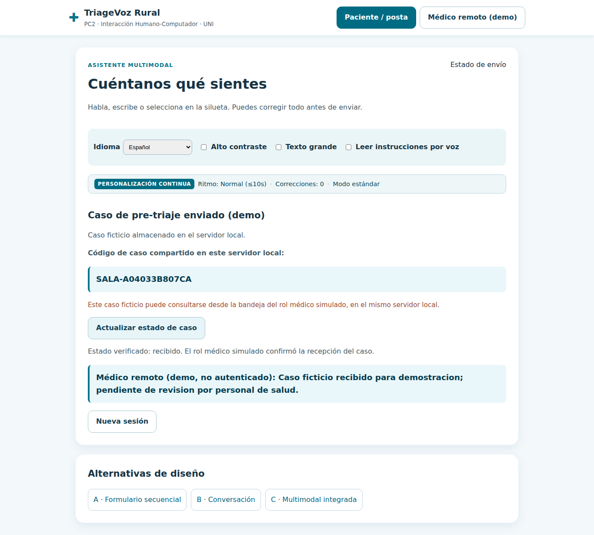

# Evidencias funcionales E2E — TriageVoz Rural

> **Integrantes — Grupo 10, UNI, CC451 (PC2)**  
> Santa Cruz Basilio, Jesus Diego — 20235005G  
> López Arteaga, César Omar — 20215508C  
> Pumayauli Evangelista, Bryan José — 20212209E

## Procedencia de las capturas

Las cinco imágenes de esta sección se capturaron **automáticamente del navegador Chromium mientras se ejecutaba la aplicación real** en GitHub Actions, contra `http://127.0.0.1:4173`, con datos de demostración inventados. No son dibujos ni pantallas reconstruidas. Se generaron en una sesión independiente de las capturas manuales compartidas por el equipo.

La ejecución reproduce el recorrido paciente → servidor → rol médico simulado → paciente → recarga, y falla si no se satisfacen las condiciones comprobadas mediante Playwright.

| Código | Paso comprobado | Evidencia |
|---|---|---|
| E2E-01 | Caso ficticio creado y enviado | [01 — Caso enviado](../assets/evidencias-integracion/01-caso-enviado.png) |
| E2E-02 | Caso aparece en la bandeja del rol médico | [02 — Bandeja de casos](../assets/evidencias-integracion/02-bandeja-casos.png) |
| E2E-03 | Acuse confirmado, respuesta preservada e historial visible | [03 — Acuse e historial](../assets/evidencias-integracion/03-confirmacion-historial.png) |
| E2E-04 | Paciente consulta el estado y recibe la respuesta | [04 — Respuesta al paciente](../assets/evidencias-integracion/04-respuesta-paciente.png) |
| E2E-05 | Tras recargar, recupera caso y mensaje guardado | [05 — Recuperación](../assets/evidencias-integracion/05-recarga-caso.png) |

## Evidencia visual destacada

## Reproducción técnica

- Código de la automatización: [`scripts/capturar_evidencias_e2e.mjs`](../scripts/capturar_evidencias_e2e.mjs).
- Flujo ejecutado en GitHub Actions: [`.github/workflows/capturas-e2e.yml`](../.github/workflows/capturas-e2e.yml).
- Cinco archivos originales PNG se mantienen en [`assets/evidencias-integracion/`](../assets/evidencias-integracion/).
- Condiciones verificadas: silueta, cuatro respuestas, resumen local, creación de código, listado, consulta, acuse, respuesta, historial y recuperación tras recarga.
- Entorno: Node.js 22, Chromium headless y almacenamiento JSON temporal de demostración.

Para repetir el procedimiento, ejecutar el flujo de GitHub Actions en la rama de mantenimiento apropiada o seguir los pasos del script con Playwright disponible.

## Diferencia respecto a las pruebas manuales

Las capturas de la aplicación local del equipo muestran, entre otros, el caso ficticio `SALA-555CEF76E974`. **Las capturas automatizadas documentan otro caso ficticio independiente** y no sustituyen la evidencia manual ni representan la misma sesión. Se mantienen también las imágenes históricas en `assets/`.

## Alcance y limitaciones

Este procedimiento demuestra un flujo local automatizado y la interacción entre **dos roles simulados**. No comprueba una conexión clínica real, una videollamada, una autenticación médica, evaluación de usabilidad con pacientes ni validez diagnóstica.
